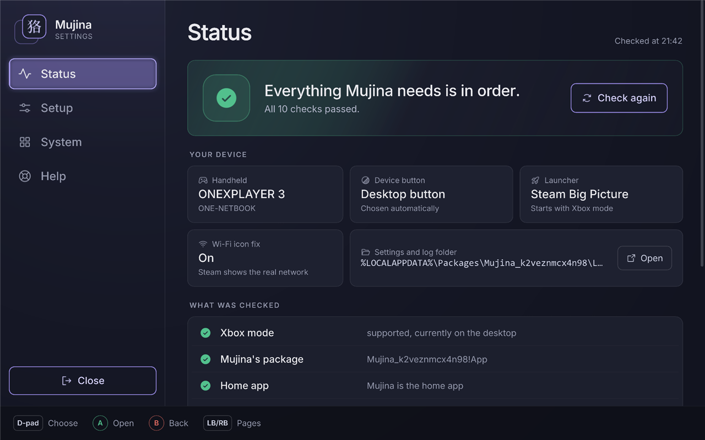

<p align="center"></p>

# Mujina 狢

Mujina makes a Windows 11 handheld start like a console. It registers as the home app of Xbox
mode (Windows' "full screen experience") and opens **Steam Big Picture** in its place, so the
device boots straight into Steam.

> A *mujina* (狢) is a shapeshifter from Japanese folklore. It takes another form to get into
> places it could not enter otherwise. Windows only accepts a "gaming home app" as the Xbox mode
> home, so Mujina takes that form and starts Steam instead.

> [!NOTE]
> Mujina is young and tested on one device, a OneXPlayer 3. Other handhelds work, but their
> extra button needs a profile or a one-time capture in the settings.

## Why Mujina

I got a OneXPlayer 3 and wanted it to work like SteamOS: turn it on, Steam opens. [AnyFSE] and
[OmniConsole] already do this for Xbox mode, but neither fit my device and setup completely. So
I wrote my own, heavily inspired by them. **I recommend AnyFSE for most people:** more people
use it, it supports more launchers and devices, and it is more mature.

What Mujina does differently:

- **Steam only.** Other launchers can be started, but most features need Steam,
  such as the Wi-Fi icon and the device button.
- **No idle cost.** No polling: it waits on Windows events and uses almost no CPU while idle.
- **Nothing inside other programs.** No code injection, no reading other processes' memory, no
  driver, no service.
- **One file.** Written in Rust. One signed installer, no runtime needed.

## Features

| Feature | What it does |
|---|---|
| **Boot into Steam** | Starts Big Picture, or switches a running Steam to it, and gives it focus. Restarts it if it crashes. |
| **Device button** | The OneXPlayer "show desktop" button opens the Steam menu, or the Steam overlay in a game. Elsewhere in Xbox mode it goes back to the game or to Big Picture. On the desktop it still shows the desktop. |
| **Wi-Fi icon** | Big Picture on Windows shows Wi-Fi as disconnected (a Steam bug). Mujina shows the real network and signal. Only cosmetic: Wi-Fi works either way, and you still can't change networks in Steam. The empty icon just bothered me. |
| **Loading screens** | Optionally a black screen while Steam starts, and Steam's "game is starting" screen kept in front while a game loads. |
| **Mujina Settings** | Works with touch and the controller, full screen in Xbox mode. Changes apply without leaving Xbox mode. |

## Install

You need Windows 11 24H2 or later with Xbox mode, and Steam. Windows turns Xbox mode on only
for some handhelds; on others, unlock it first, for example with the
[Xbox Full Screen Experience Tool].

1. Download `Mujina-Setup-vX.Y.Z.exe` from the [releases] and run it. If SmartScreen warns,
   choose *More info → Run anyway* (Mujina uses its own certificate).
2. Choose **Install**. The first time, Windows asks for administrator rights once, to turn on
   Developer Mode and trust the certificate. Every tool of this kind needs Developer Mode.
3. Enter Xbox mode. Steam opens.

To update, run a newer Setup. To uninstall: Mujina Settings → *System* → **Remove Mujina**.
[docs/install.md](docs/install.md) has the details: why Developer Mode, the quiet install and
its exit codes, the location prompt, and what to do when Smart App Control blocks Setup.

## Settings

A supported device needs no settings. For everything else, open **Mujina Settings** from the
Start menu: *Status*, *Setup* (launcher, device button with *Capture*, fixes), *System* (home
app, what Windows allows) and *Help* (log, language). Every change is saved at once, and a short
message says whether it applies now or the next time you enter Xbox mode.



- **More pages:** [docs/screenshots.md](docs/screenshots.md).
- **In Xbox mode:** add `mujina-settings.exe` from `%LOCALAPPDATA%\Microsoft\WindowsApps` to
  Steam as a non-Steam game (the *System* page shows the full path). It opens full screen and
  works with the controller.
- **By hand:** edit the plain `config.toml`, or run
  `mujinactl config set launcher.steam.wifi_indicator false`. The doctor reports mistakes, and
  they never stop Steam from starting.
- **Another device:** if its extra button sends a key combination, *Capture* is all it takes.
  For a built-in profile, see [docs/new-device.md](docs/new-device.md) or open a
  [device report](https://github.com/Tokahiro/mujina/issues/new/choose).

## Troubleshooting

```
mujinactl doctor    # checks everything Mujina depends on, also writes doctor.txt
mujinactl paths     # where the config, log and doctor.txt are
```

For a bug report, switch on *Write down everything* (Mujina Settings → Help, or
`mujinactl config set logging.level debug`), reproduce the problem, and attach `mujina.log`
(and `mujina.log.1`, if there is one) and `doctor.txt` to an
[issue](https://github.com/Tokahiro/mujina/issues).

## Building

Rust, in the version `rust-toolchain.toml` pins. Every crate builds and tests on any OS, the
Windows parts only on Windows; the package needs the Windows SDK (`makeappx`, `signtool`).

```
rustup toolchain install
cargo test --locked --workspace
cargo xtask arch-check
cargo xtask i18n-check
cargo xtask package
```

`cargo xtask dist --pfx <file>` builds what a release publishes, signed with a development
certificate of your own ([CONTRIBUTING.md](CONTRIBUTING.md#a-release-shaped-build)).
`cargo xtask new-launcher <id>` and `cargo xtask new-device <id>` start a launcher or a device.

[CONTRIBUTING.md](CONTRIBUTING.md) has the ground rules and workflow. The rest is in
[docs/](docs): [architecture](docs/architecture.md), [decisions](docs/adr/README.md),
[a new launcher](docs/new-launcher.md), [a new device](docs/new-device.md),
[on-device tests](docs/on-device-checklist.md) and [signing](docs/signing.md).
[SECURITY.md](SECURITY.md) says what Mujina changes on your system and how to report a
vulnerability; [CHANGELOG.md](CHANGELOG.md) lists every release.

## AI use

Of course I use AI, like every other tool that helps me develop. Algorithms have helped with
coding for a long time: autocomplete, refactoring tools, linters, formatters, the compiler's
"did you mean …?". To me, coding agents are the next step of the same thing. I also ask an AI
chat to find things and help me debug (sorry, Stack Overflow), to name things (I hate naming
things), and to write commits and docs, which dyslexia doesn't make easier. I am a software
engineer, not a designer, so Claude definitely helped me with the design.

## License

[MIT](LICENSE-MIT) or [Apache 2.0](LICENSE-APACHE), at your option. Third-party notices are in
[NOTICE](NOTICE). Mujina is not affiliated with Valve, Microsoft or any device manufacturer.

Mujina Settings and Mujina Setup are built with [Slint](https://slint.dev), under its
royalty-free licence, which asks for this badge:

<a href="https://slint.dev"></a>

[AnyFSE]: https://github.com/ashpynov/AnyFSE
[OmniConsole]: https://github.com/8bit2qubit/OmniConsole
[Xbox Full Screen Experience Tool]: https://github.com/8bit2qubit/XboxFullScreenExperienceTool
[releases]: https://github.com/Tokahiro/mujina/releases
